# FoundryAI — The AI Startup Team for Any AI Workspace

> 58 specialist agents + 9 team coordinators + 54 skills for **every kind of AI startup**, from LLM apps and agents to voice, vision, generative media, robotics, model training and vertical AI.
> Works in **Claude Code, Cursor, GitHub Copilot, Codex, Gemini CLI**, every `AGENTS.md`-compatible agent, and chat workspaces like ChatGPT, Claude and Gemini projects.

[](https://opensource.org/licenses/MIT)
[](#the-team--58-specialists)
[](#skills--54-skills)
[](#works-in-any-ai-workspace)



---

## What is this?

An AI startup needs architects, engineers, product people, a growth team, security and legal, long before it can hire them. FoundryAI gives you that team as specialist agents and reusable skills, in whichever AI workspace you already use.

**Ask for `/cofounder "build me a RAG-powered document search"` and get:**
- `ai-architect` designing the system
- `ai-engineer` implementing the embedding pipeline
- `ai-backend-engineer` building the API
- `ai-qa-engineer` setting up evals

Every agent first works out what kind of AI startup you are and what stage you're at, and recommends the simplest thing that works for you now.

---

## Install

```bash
curl -fsSL https://raw.githubusercontent.com/VenkataAnilKumar/FoundryAI/main/install.sh | bash
```

The installer detects the AI workspaces on your machine and installs the agents and skills in each one's native format. Choose explicitly with `--target`:

```bash
curl -fsSL https://raw.githubusercontent.com/VenkataAnilKumar/FoundryAI/main/install.sh | bash -s -- --target cursor --target codex
```

Or from a clone:

```bash
git clone https://github.com/VenkataAnilKumar/FoundryAI
cd FoundryAI
./install.sh --dry-run             # preview what will change
./install.sh --target all          # every workspace, including chat prompts
```

The installer needs `python3`. It backs up any file it would overwrite and records what it installed, so you can remove it cleanly:

```bash
curl -fsSL https://raw.githubusercontent.com/VenkataAnilKumar/FoundryAI/main/uninstall.sh | bash
```

---

## Works in any AI workspace

One neutral source is built into each workspace's native format by [`scripts/build.py`](scripts/build.py).

| Workspace | `--target` | Agents | Skills |
|---|---|---|---|
| **Claude Code** | `claude` | `~/.claude/agents/` | `~/.claude/skills/` |
| **Cursor** | `cursor` | `~/.cursor/agents/` | `~/.agents/skills/` |
| **GitHub Copilot / VS Code** | `copilot` | `~/.copilot/agents/*.agent.md` | `~/.copilot/skills/` |
| **OpenAI Codex CLI** | `codex` | `~/.codex/agents/*.toml` | `~/.agents/skills/` |
| **Gemini CLI** | `gemini` | `~/.gemini/agents/` | `~/.agents/skills/` |
| **Other agents** (Windsurf, Cline, Roo, Zed, Amp, Junie, …) | `cursor` or `codex` | — | `~/.agents/skills/` ([Agent Skills](https://agentskills.io) standard) |
| **Chat workspaces** (ChatGPT Projects & GPTs, Claude Projects, Gemini Gems) | `chat` | paste-ready prompts in `~/FoundryAI-chat-prompts/` | same folder |

Project instructions use [`AGENTS.md`](templates/AGENTS.md), which most agents read directly; see [Project Templates](#project-templates) for Claude Code and Gemini CLI.

**Claude Code plugin.** Claude Code users can also install everything as a plugin:

```
/plugin marketplace add VenkataAnilKumar/FoundryAI
/plugin install founders-kit@foundryai
```

---

## What's Included

| | Count | What |
|---|---|---|
| **Agents** | 58 + 9 teams | Specialists across architecture, engineering, AI modalities, product, data & AI, fundraising, growth, safety |
| **Skills** | 54 | `/review`, `/debug`, `/prd`, `/eval`, `/rag-design`, `/cost-check`, `/cofounder`... |
| **Project templates** | 4 | Stack-specific `AGENTS.md` files for your project |
| **Workflow recipes** | 31 | Copy-paste team recipes ([15](templates/WORKFLOWS.md)) + team workflows ([16](agents/WORKFLOWS.md)) |
| **Hooks** | 3 | Claude Code automations (secret-file protection, logging, notifications) |
| **MCP configs** | 3 | GitHub, PostgreSQL, full-stack server configs |

---

## The Team — 58 Specialists

### Leadership (6)
| Agent | Best For |
|---|---|
| `founder` | Your AI co-founder — thinks strategically, delegates to the right team, ships |
| `cto-advisor` | Build-vs-buy decisions, hiring plans, tech debt strategy, scaling engineering teams |
| `engineering-manager` | Team health, delivery cadence, performance reviews, hiring |
| `technical-program-manager` | Cross-team coordination, OKRs, program tracking |
| `ai-orchestrator` | Complex multi-agent workflow coordination |
| `ai-fundraising-advisor` | Raise strategy, pitch deck, AI investor metrics, data room, term sheets, investor updates |

### Architecture (7)
| Agent | Best For |
|---|---|
| `ai-architect` | AI system design, LLM/RAG architecture, tech stack decisions |
| `cloud-architect` | AWS/GCP/Azure infrastructure, multi-cloud, IaC |
| `data-architect` | Data lakehouse, warehouse, modeling, lineage |
| `integration-architect` | API gateways, event mesh, microservices integration |
| `security-architect` | Threat modeling, zero-trust, security frameworks |
| `software-architect` | Application architecture, DDD, ADRs, hexagonal design |
| `staff-engineer` | Cross-team technical leadership, engineering standards |

### Engineering (12)
| Agent | Best For |
|---|---|
| `ai-engineer` | LLM integration, RAG pipelines, embeddings, Claude/OpenAI API |
| `ai-backend-engineer` | APIs, databases, async processing, microservices |
| `ai-frontend-engineer` | React/Next.js, streaming UI, AI chat interfaces |
| `ai-fullstack-engineer` | End-to-end features across the full stack |
| `ai-mobile-engineer` | React Native, Flutter, iOS/Android, on-device AI |
| `ai-database-engineer` | PostgreSQL, vector DBs, migrations, query optimization |
| `ai-api-designer` | REST/GraphQL/gRPC design, OpenAPI specs, DX |
| `ai-software-engineer` | General coding across any language/framework |
| `ai-agent-engineer` | Multi-agent systems, tool use, autonomous workflows |
| `ai-devops-engineer` | CI/CD, Docker/K8s, model deployment, MLOps |
| `ai-qa-engineer` | LLM evals, test frameworks, adversarial testing |
| `ai-performance-engineer` | Latency, throughput, Core Web Vitals, load testing, query tuning |

### Platform (4)
| Agent | Best For |
|---|---|
| `ai-platform-engineer` | Internal AI platform, model serving, GPU infra |
| `ml-engineer` | ML model training, fine-tuning, serving pipelines |
| `site-reliability-engineer` | SLOs, incident response, reliability engineering |
| `release-manager` | Release coordination, rollout strategy, feature flags |

### Product (8)
| Agent | Best For |
|---|---|
| `ai-product-manager` | PRDs, roadmaps, user stories, OKRs, GTM planning |
| `ai-ux-designer` | User flows, wireframes, AI UX patterns, onboarding design |
| `ux-researcher` | User interviews, usability testing, JTBD, personas |
| `product-designer` | Hi-fi designs, design systems, Figma handoff |
| `product-marketing-manager` | Positioning, launch plans, competitive intel, battlecards |
| `product-analyst` | Funnel analysis, cohort retention, A/B testing |
| `technical-product-manager` | Developer-facing products, APIs/SDKs, DX metrics |
| `ai-strategy-engineer` | AI strategy docs, competitive analysis, 3-year roadmaps |

### Data & AI (7)
| Agent | Best For |
|---|---|
| `ai-data-engineer` | ETL pipelines, data warehouse, stream processing |
| `ai-data-scientist` | Statistical analysis, ML modeling, A/B testing |
| `ai-analytics-engineer` | KPI dashboards, funnel analysis, BI reporting |
| `ai-domain-expert` | Deep domain knowledge and expert validation |
| `ai-prompt-engineer` | Prompt design, optimization, evaluation, few-shot examples |
| `ai-research-engineer` | Paper implementation, experiments, new techniques |
| `ai-model-training-engineer` | Fine-tuning, post-training (DPO/RL), distillation, pretraining, GPU compute plans |

### AI Modalities (4)
| Agent | Best For |
|---|---|
| `ai-voice-engineer` | Real-time voice agents, phone bots, STT/TTS, latency and turn-taking |
| `ai-vision-engineer` | Detection, segmentation, document AI, vision-language models, edge vision |
| `ai-generative-media-engineer` | Image, video and audio generation, style fine-tuning, GPU serving, content safety |
| `ai-robotics-engineer` | ROS 2, simulation and sim-to-real, imitation learning, VLA policies, robot safety |

### Growth (4)
| Agent | Best For |
|---|---|
| `ai-finance-engineer` | Runway and burn, financial models, AI gross margin, GPU/LLM spend, credits |
| `ai-sales-engineer` | Founder-led and enterprise AI sales, pilots that convert, security reviews, retention |
| `ai-growth-engineer` | Content strategy, SEO, AI-powered growth experiments |
| `developer-advocate` | DevRel, DX, community, technical content |

### Knowledge (3)
| Agent | Best For |
|---|---|
| `ai-technical-writer` | API docs, architecture docs, knowledge bases |
| `ai-accessibility-engineer` | WCAG 2.2, screen readers, keyboard nav, ARIA patterns |
| `content-designer` | UX writing, microcopy, content strategy |

### Safety (3)
| Agent | Best For |
|---|---|
| `ai-security-engineer` | Threat modeling, prompt injection, red teaming |
| `ai-responsible-engineer` | Bias audits, fairness, safety, EU AI Act compliance |
| `ai-legal-engineer` | GDPR, IP, contracts, regulatory analysis |

### Team Coordinators (9)
Use a team coordinator when you want the whole team to work together on a problem.

| Coordinator | Delegates To |
|---|---|
| `team-leadership` | founder, cto-advisor, engineering-manager, technical-program-manager, ai-orchestrator, ai-fundraising-advisor |
| `team-architecture` | ai-architect, cloud-architect, data-architect, integration-architect, security-architect, software-architect, staff-engineer |
| `team-engineering` | The engineering and AI modality specialists (voice, vision, generative media, robotics) |
| `team-platform` | ai-platform-engineer, ml-engineer, site-reliability-engineer, release-manager |
| `team-product` | All 8 product specialists |
| `team-data-ai` | All 7 data & AI specialists |
| `team-growth` | ai-finance-engineer, ai-sales-engineer, ai-growth-engineer, developer-advocate |
| `team-knowledge` | ai-technical-writer, ai-accessibility-engineer, content-designer |
| `team-safety` | ai-security-engineer, ai-responsible-engineer, ai-legal-engineer |

---

## Routing

The routing skills pick the right specialists for you:

```
/cofounder "build a RAG-powered document Q&A feature"
→ Thinks strategically, routes to: ai-architect + ai-engineer + ai-backend-engineer

/cofounder "we need to be GDPR compliant before launch"
→ Routes to: ai-legal-engineer + ai-responsible-engineer (parallel)

/cofounder "our API latency is 2 seconds — fix it"
→ Routes to: ai-performance-engineer + ai-database-engineer

/engineering "design the database schema for conversation history"
→ Routes to: ai-database-engineer

/product "write a PRD for AI-powered search"
→ Routes to: ai-product-manager

/business "set up a security review for our AI API"
→ Routes to: ai-security-engineer
```

---

## Skills — 54 Skills

Skills follow the open [Agent Skills](https://agentskills.io) standard. Invoke them as `/name` in workspaces with slash commands, or just describe the task and the agent picks the skill.

### Routing
| Command | What it does |
|---|---|
| `/cofounder "task"` | Your AI co-founder — thinks strategically, routes to the right specialists |
| `/engineering "task"` | Routes an engineering task to the right engineer(s) |
| `/product "task"` | Routes a product, design or strategy task |
| `/business "task"` | Routes a business, data, ops or compliance task |

### Code Quality
| Command | What it does |
|---|---|
| `/review` | Code review: logic, security, performance — CRITICAL/HIGH/MEDIUM/LOW |
| `/review-ai` | AI-specific: prompt injection, hallucination risks, PII leakage, token cost |
| `/refactor` | Structured refactoring with safety checklist — no behavior changes |
| `/debug "error"` | 6-step debugging: symptom → evidence → hypotheses → fix → verify |
| `/security-scan` | Fast OWASP top 10 triage scan of any file |
| `/test-plan "feature"` | Complete test plan: unit, integration, E2E, edge cases |
| `/explain` | Plain-language explanation of any code with examples |

### Feature Development
| Command | What it does |
|---|---|
| `/feature "name"` | Classifies feature, routes to right agents in parallel |
| `/architect "challenge"` | Routes to the right architect specialist (AI, cloud, data, integration, security, app) |
| `/design "challenge"` | Routes to the right design/UX specialist (research, UX, visual, content, metrics) |
| `/prd "idea"` | Lean PRD: user stories, acceptance criteria, success metrics |
| `/spec "component"` | Technical spec: interface, behavior, error cases, data model |
| `/estimate "task"` | T-shirt sizing with breakdown, risk multipliers, unknowns |

### AI / LLM Specific
| Command | What it does |
|---|---|
| `/prompt "text"` | Optimize any prompt — diagnosis, rewrite, diff of changes |
| `/eval "feature"` | Design an eval suite — 15+ test cases, scoring, regression strategy |
| `/rag-design` | RAG architecture: chunking, embeddings, vector DB, retrieval |
| `/cost-check` | Token cost estimate at scale + ranked optimization recommendations |
| `/agent-design "role"` | Design a new agent — outputs a complete ready-to-use `.md` file |
| `/agent-systems "system"` | Design multi-agent orchestration, tool use, memory, failure handling |
| `/mlops` | ML training pipelines, fine-tuning, model serving, drift monitoring |
| `/responsible-ai` | Bias audit, fairness eval, red-team checklist, explainability |
| `/experiment "hypothesis"` | A/B test design, statistical analysis, ML model evaluation |
| `/model-strategy` | API vs open-weight vs fine-tune vs train — providers, cost, lock-in, switching triggers |

### AI Startup Business
| Command | What it does |
|---|---|
| `/pitch-deck` | Slide-by-slide AI pitch deck, answers to "isn't this a wrapper?", skeptical-investor teardown |
| `/investor-update` | Monthly investor update with metrics, AI cost and quality, and asks |
| `/pmf-check` | Product-market fit scorecard with AI-specific traps (novelty usage, pilot purgatory) |
| `/moat` | Defensibility assessment: data flywheel, workflow depth, distribution, switching costs |
| `/ai-pricing` | Seat vs usage vs credits vs outcome pricing, tiers, gross margin after inference |
| `/security-questionnaire` | Answer enterprise security and AI-governance reviews; close deal-blocking gaps |
| `/data-rights` | Rights to train on / use customer, scraped, licensed and synthetic data |

### Product & Design
| Command | What it does |
|---|---|
| `/prd "idea"` | Lean PRD: user stories, acceptance criteria, success metrics |
| `/spec "component"` | Technical spec: interface, behavior, error cases, data model |
| `/metrics "product"` | Define north star, funnel, A/B test plan, dashboard design |
| `/gtm "launch"` | Go-to-market: positioning, messaging, launch plan, competitive battlecards |
| `/growth "product"` | Growth strategy: acquisition funnels, retention levers, viral loops |
| `/ai-strategy` | AI opportunity assessment, build-vs-buy, competitive landscape, roadmap |

### Platform & Infrastructure
| Command | What it does |
|---|---|
| `/data-pipeline` | ETL/ELT design, streaming vs batch, data quality gates, lineage |
| `/performance` | Diagnose latency, Core Web Vitals, DB query tuning, load testing |
| `/mobile` | iOS/Android/RN/Flutter patterns, on-device AI, app store prep |
| `/release-plan` | Rollout strategy: canary, feature flags, phased launch, rollback |

### Safety, Compliance & Accessibility
| Command | What it does |
|---|---|
| `/compliance` | GDPR/CCPA/EU AI Act, data privacy, AI risk register |
| `/accessibility` | WCAG 2.2 audit, screen readers, keyboard nav, ARIA patterns |

### Docs & Community
| Command | What it does |
|---|---|
| `/docs` | Docstrings, API docs, architecture docs |
| `/changelog "v1.2.0"` | CHANGELOG entry from recent git commits |
| `/release "v2.0.0"` | Release notes: highlights, breaking changes, upgrade steps |
| `/standup` | Standup update from recent git activity |
| `/onboard` | 30-day engineer onboarding guide for your codebase |
| `/devrel` | DevRel strategy: DX audit, community, technical content, OSS |

### Launch & Ops
| Command | What it does |
|---|---|
| `/launch-check` | 40-point pre-launch checklist — security, ops, compliance, comms |
| `/incident "error"` | Incident response: severity triage, RCA, postmortem template |
| `/migrate` | Migration plan: zero-downtime strategy, rollback, data safety |
| `/api-test` | Full API test suite from endpoint description or OpenAPI spec |

→ Full reference: [`docs/skills.md`](docs/skills.md)

---

## Project Templates

Drop a stack-specific `AGENTS.md` into your project root. It records your AI startup type, stage and stack, and configures agent routing for your setup.

| Template | Stack |
|---|---|
| [`AGENTS.md`](templates/AGENTS.md) | Generic — works for any project |
| [`AGENTS-nextjs-saas.md`](templates/AGENTS-nextjs-saas.md) | Next.js 14 + FastAPI + PostgreSQL + LLM API |
| [`AGENTS-python-ml.md`](templates/AGENTS-python-ml.md) | PyTorch / HuggingFace + MLflow + FastAPI |
| [`AGENTS-react-native.md`](templates/AGENTS-react-native.md) | Expo + FastAPI + EAS Build |

```bash
cp FoundryAI/templates/AGENTS-nextjs-saas.md ./AGENTS.md
```

- **Codex, Cursor, Copilot, Windsurf, Zed, Amp…** read `AGENTS.md` directly.
- **Claude Code:** `echo '@AGENTS.md' > CLAUDE.md`
- **Gemini CLI:** add `"context": { "fileName": ["AGENTS.md", "GEMINI.md"] }` to `.gemini/settings.json`.
- **Chat workspaces:** upload it as project knowledge.

---

## Hooks & MCP

### Hooks — Claude Code automations

```bash
./install.sh --hooks      # copies the scripts to ~/.claude/hooks
```

Then register them in `~/.claude/settings.json` — the snippet is in [`templates/hooks-setup.md`](templates/hooks-setup.md). Hooks need `jq` or `python3`.

| Hook | Trigger | Does |
|---|---|---|
| `protect-env-files.sh` | Before Write/Edit | Blocks writes to `.env*`, `*.pem`, `*.key`, `secrets.*`, `credentials.*`, SSH keys (fails closed) |
| `log-agent-usage.sh` | After every subagent call | Logs to `~/.claude/logs/agent-usage.log` |
| `notify-on-complete.sh` | Prompt submit + Stop | Desktop notification when a turn takes over 30s (Windows/Mac/Linux) |

### MCP Servers — Connect your agents to your infrastructure

```bash
# GitHub (issues, PRs, code search)
cp FoundryAI/templates/mcp-github.json ./.mcp.json

# PostgreSQL (query your DB directly)
cp FoundryAI/templates/mcp-postgres.json ./.mcp.json

# Full stack (GitHub + PostgreSQL + Filesystem)
cp FoundryAI/templates/mcp-full-stack.json ./.mcp.json
```

These use the `.mcp.json` format (Claude Code). Most other workspaces take the same `mcpServers` block in their own config file, such as `.cursor/mcp.json` or `.vscode/mcp.json`. See [`templates/hooks-setup.md`](templates/hooks-setup.md) for full setup instructions.

---

## Usage Examples

### Single agent
```
Use the ai-architect agent to review our system design and identify scaling risks.
```

### Parallel agents
```
Use ai-frontend-engineer and ai-backend-engineer in parallel to build
user authentication — frontend handles the UI, backend handles the JWT API.
```

### Full project with the founder
```
Use the founder agent to plan and execute our AI product launch —
architecture, engineering, compliance, docs, and marketing.
```

### Workflow recipe
Copy any recipe from [`templates/WORKFLOWS.md`](templates/WORKFLOWS.md) and paste into your AI workspace to launch a pre-configured team for 15 common scenarios.

---

## File Structure

```
FoundryAI/
├── agents/                          ← single source: 58 specialists + 9 team coordinators
│   ├── founder.md                   ← AI co-founder (master orchestrator)
│   ├── team-*.md                    ← 9 team coordinators
│   ├── _shared/                     ← operating principles added to every agent
│   └── ... (workspace-neutral: tier + capabilities, mapped per workspace at build time)
├── skills/<name>/SKILL.md           ← 54 skills (Agent Skills standard)
├── templates/
│   ├── AGENTS*.md                   ← project templates (generic, Next.js SaaS, Python ML, React Native)
│   ├── WORKFLOWS.md                 ← 15 pre-built team recipes
│   ├── hooks/                       ← 3 Claude Code hook scripts
│   └── mcp-*.json                   ← MCP server configs
├── scripts/
│   ├── build.py                     ← builds every workspace format (and the Claude plugin)
│   ├── validate.sh                  ← CI: frontmatter, references, counts, all build targets, hooks
│   ├── gen-docs.py                  ← regenerates docs/agents.md, docs/skills.md, founder roster
│   └── test-hooks.sh                ← hook tests
├── plugin/                          ← Claude Code plugin (generated by build.py)
├── .claude-plugin/marketplace.json  ← lets Claude Code install the plugin from this repo
├── docs/                            ← agents.md, skills.md (generated), routing.md
├── install.sh                       ← multi-workspace installer (--target, --dry-run, --hooks)
└── uninstall.sh                     ← removes exactly what install.sh installed
```

---

## Requirements

- One or more AI workspaces: Claude Code, Cursor, GitHub Copilot (VS Code), Codex CLI, Gemini CLI, any `AGENTS.md` / Agent Skills compatible agent — or a chat workspace (ChatGPT, Claude, Gemini)
- `python3` and `git` for the installer
- Subagent support varies by workspace; where agents can't run other agents, coordinators tell you which specialist to use next

---

## Contributing

PRs welcome. To add a new agent, see [`CONTRIBUTING.md`](CONTRIBUTING.md).
The quality bar: every agent should be specific enough that a developer knows exactly when to use it and what to expect back.

---

## License

MIT — use freely, build products, ship it.

---

*Built by [VenkataAnilKumar](https://github.com/VenkataAnilKumar) · Works with Claude Code, Cursor, GitHub Copilot, Codex, Gemini CLI and more*
